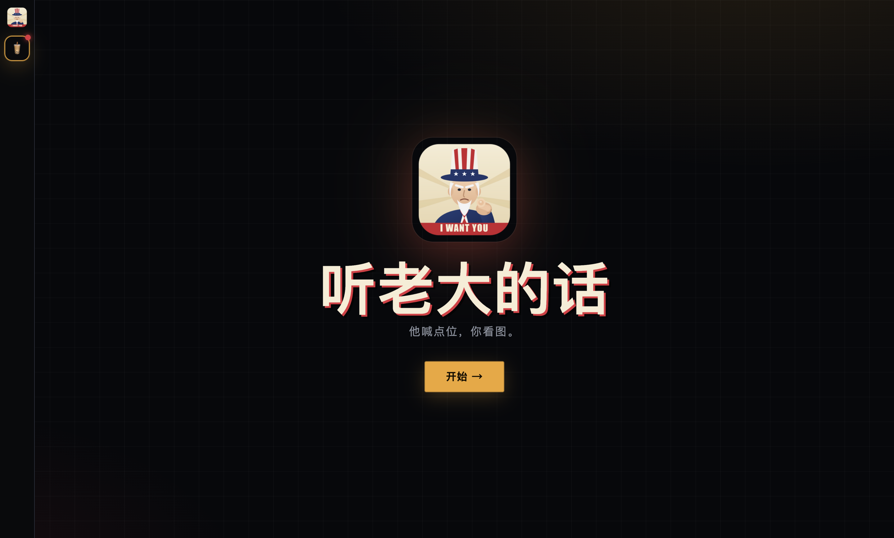
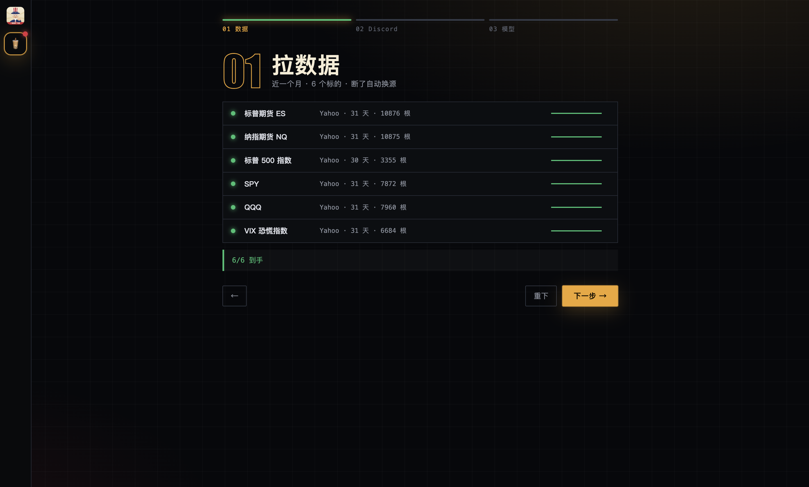
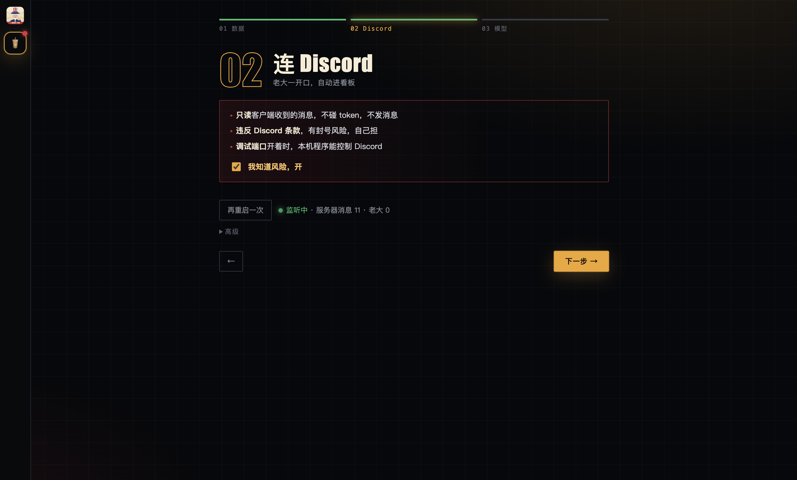
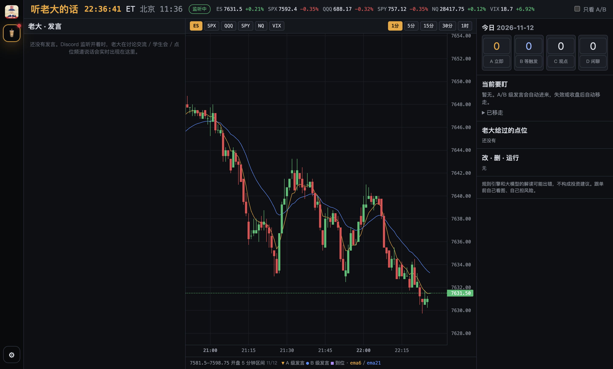
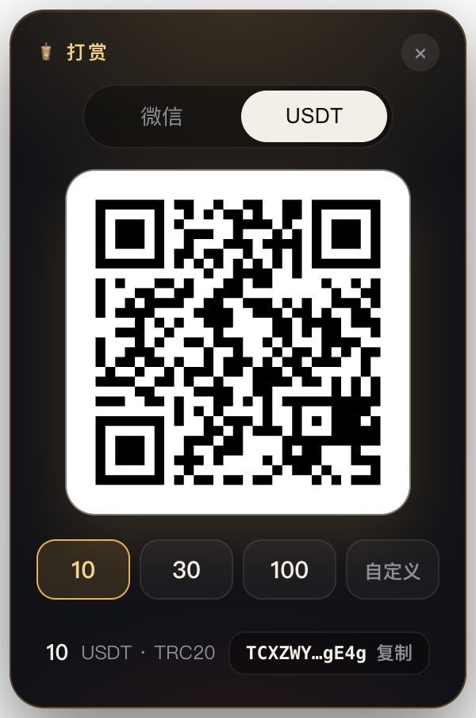

<h1 align="center">听老大的话</h1>

美股看盘客户端：老大在 Discord 里说的点位，自动标到 K 线上。Windows / macOS，免费。

## 下载

到 **[Releases](../../releases/latest)** 下载：

| 系统 | 文件 |
|---|---|
| Windows 10 / 11 | `TingLaoDa-x.y.z-win-x64-setup.exe` |
| Mac（M1 / M2 / M3 / M4） | `TingLaoDa-x.y.z-mac-arm64.dmg` |
| Mac（Intel） | `TingLaoDa-x.y.z-mac-x64.dmg` |

**第一次打开**

- **Mac**：拖进「应用程序」后，右键 →「打开」。macOS 15 以后是「系统设置 → 隐私与安全性」→「仍要打开」。
- **Windows**：弹出蓝色的「Windows 已保护你的电脑」时，点「更多信息」→「仍要运行」。

两边都没有付费的开发者签名，所以会有这一步。

## 能干什么

- 自动收老大在讨论交流、学生会、点位频道的发言，按「立即 / 等触发 / 观点 / 闲聊」分级
- 他给的点位自动画在 ES、SPX、QQQ、SPY、NQ、VIX 的 K 线上；价格第一次碰到点位，时间轴上打标
- A/B 级发言弹系统通知；失效或收盘后自动移出「当前要盯」
- 可选接大模型（DeepSeek / Claude / OpenAI / Gemini / 第三方中转），把发言写成「触发 / 位置 / 失效」卡片；不接也能用

## 打开后三步

1. **拉数据**：下载最近一个月的 K 线（Yahoo，限流时自动换东方财富 / CBOE）
2. **连 Discord**：同意风险说明后，自动带调试端口重启你的 Discord 客户端，只读它收到的消息
3. **接大模型**：可选，不填也能用

每一步都能跳过，之后在左下角 ⚙ 里随时补。

 

 

## 丑话说在前面

- 监听只读你自己 Discord 客户端**收到**的消息，不读账号密码和 token，不发消息，不调 Discord 接口，数据只存在你电脑上。但这属于对客户端的自动化，**违反 Discord 服务条款，理论上有封号风险**，开不开你自己决定。
- 调试端口开着时，本机其他程序也能控制这个 Discord 客户端。不用了就正常退出 Discord。
- 规则引擎和大模型都可能理解错，**不构成投资建议**，跟单自己看图、自己担风险。

## 打赏

免费用。觉得好用，看盘页左边 🧋 可以请杯奶茶（微信 / USDT）。

## 找我干活

这个客户端从想法到 Win / Mac 双端一天做完。看盘工具、自动化、小程序、App、网站，有需求直接在群里私信我。
